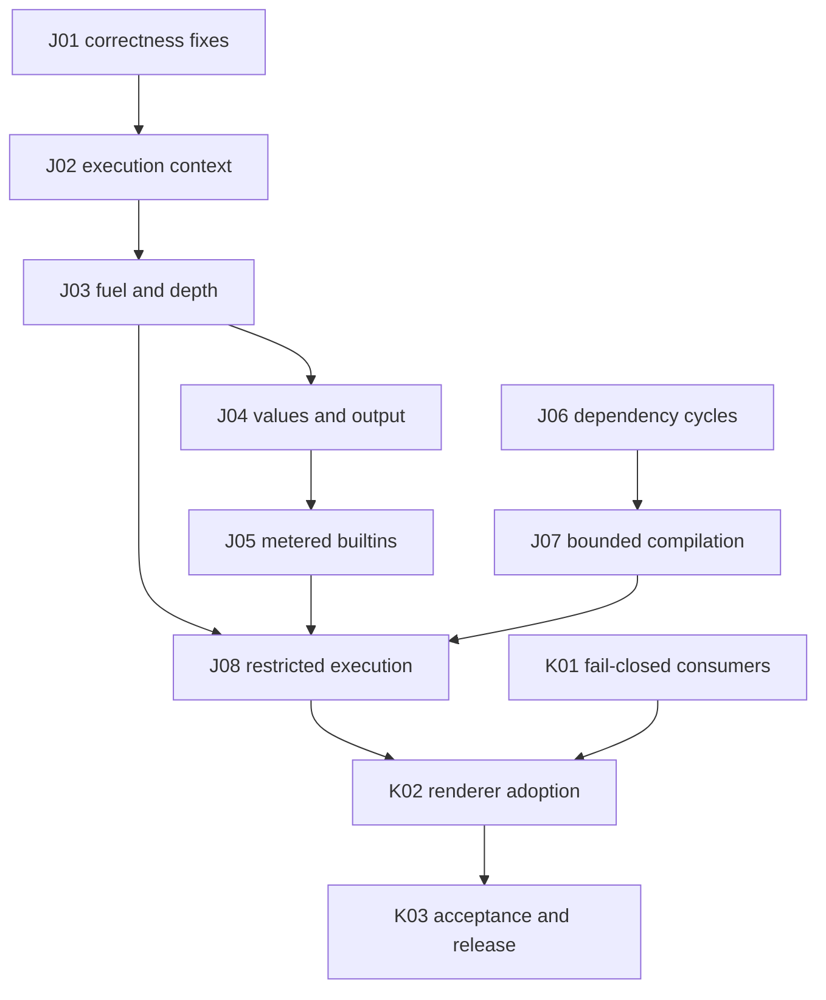

# Template execution budgets: four-lane execution plan

Prepared 2026-11-07. Implementation has since produced a combined Jet candidate. The [2026-11-08 final review](final-review.md) records current defects, benchmark results and the remaining release gates; the original assignments and acceptance requirements below remain the scope reference. Karsto adoption is outside the current finalization review. Use one implementer by default; do not start or resume agents without explicit owner direction.

Canonical decisions: [RFC index](../../rfcs/index.md). Baseline/source findings: [audit](source-audit.md). Every lane reads the global/repository guides that apply at execution time, current Git status/history, this plan, its assignment and the validation matrix. Do not copy Karsto's Go 1.27 conventions into upstream Jet, whose module declares Go 1.16; preserve the dependency's compatibility unless deliberately agreed otherwise.

## Active finalization batch

The owner authorized repairs and parallel agent execution on 2026-11-08. [Finalization assignments](finalization.md) define the active four lanes, common candidate, shared-file ownership, integration order and performance/release gates. That packet supersedes the historical lane scopes below for this batch. Karsto adoption remains excluded.

## Current publication policy

Owner direction, 2026-11-07: continue development in `ashtonian/jet`. Do not open PRs, issues or other submissions in `CloudyKit/jet`. Any future upstream submission requires a new explicit instruction from the owner.

Internal plans, RFCs, lane assignments and execution evidence stay in the fork. Exclude `docs/plans/` and `docs/rfcs/` from any future upstream submission; only relevant public API/user documentation accompanies generic code and tests.

The work IDs below describe scope and dependencies, not a required PR count. Reuse existing fork PRs and consolidate related implementation, fixes, tests and validation. Packaging can remain a separate commit within a consolidated fork PR. Do not create a PR per work ID, fix or validation stage. Preserve current branches and review history while planning consolidation; this direction does not authorize closing existing PRs or rewriting their history.

## Assignments

| Lane | Work | Start independently after execution is authorized | Dependent work |
| --- | --- | --- | --- |
| [1](lane-1-runtime.md) | Runtime lifecycle, cancellation, fuel/depth, terminal failure and cleanup | Bounded failing baseline; pool/error correctness | Exposes shared meter and policy hooks to lanes 2/3 |
| [2](lane-2-values.md) | Value/output accounting and metered builtins | Operation/cost inventory, bounded allocation reproductions, fixtures | Runtime insertions depend on lane 1's foundation |
| [3](lane-3-admission.md) | Parser/loader limits and restricted capability policy | PR #236 audit; parser baseline and bounded admission | Runtime capability checks depend on lanes 1/2 |
| [4](lane-4-integration.md) | Karsto adoption, fail-closed consumers, compatibility/performance, packaging | Consumer inventory, bounded wrapper reproduction, upstream benchmark baseline, rule-chain error propagation | Tenant adoption and release depend on all Jet protection lanes |

The lanes are scoped engineering assignments, not permanent ownership of entire upstream files. Each works in a separate checkout/task branch. Consolidate related work in that checkout; do not create a branch per small edit or duplicate validators.

## Dependency and PR sequence

Entry: independently reproducible defects. Exit: reviewed Jet changes plus Karsto acceptance. Failure: failed prerequisite blocks dependents; independent inventory, implementation and tests continue. Dependencies: work IDs remain in the [register](upstream-prs.md); actual existing PR heads and consolidated finalization packets are in the [final review](final-review.md). Reuse the existing fork PRs.

## Shared-file rules

| Surface | Rule |
| --- | --- |
| Jet `exec.go`, `eval.go`, `func.go`, `ranger.go`, new budget/error types | Lane 1 owns the foundation and runtime call contract. Lanes 2/3 prepare fixtures and new helpers meanwhile, then apply minimal evaluator patches in dependent PRs based on the recorded foundation SHA. Never maintain a duplicate evaluator. |
| Jet `default.go`, `dump.go`, new builtin/output/value helpers | Lane 2. Lane 1 supplies required `exec`/`includeIfExists` budget propagation as an explicit foundation patch before lane 2 starts modifying those functions. |
| Jet `parse.go`, `lex.go`, `set.go`, loader code, restricted policy descriptors | Lane 3. Changes to evaluator loading calls are a dependent patch against the runtime foundation. Preserve upstream PR #236 edits/attribution. |
| Jet `node.go` | Error wrapping belongs to J01; parsing changes follow that commit. Do not mix AST layout refactors into budget PRs. |
| Jet tests | Each lane adds focused files for its contract. Existing fixture/test edits follow the owning production-file PR. Lane 4 adds shared conformance/benchmark fixtures without rewriting lane regressions. |
| Jet module/import packaging, compatibility CI, release report | Lane 4, separate commits from implementation. Unit owners still run their own meaningful checks. |
| Karsto code, RFC-0578, relevant spec/README/error docs | Lane 4 for this task only. Check live queue ownership; preserve unrelated work. Existing project release and CI policies still apply. |

No implementation agent is blocked on approval of a routine internal choice already resolved by these RFCs. If a public contract must change, first update the affected RFC with evidence and impact. Owner-start authorization is still required; this document is not that authorization.

## Milestones and evidence

- [ ] M0: refresh upstream/consumer state; exact immutable inputs recorded; safe failing baselines reproduced.
- [ ] M1: J01–J03 pass; context/fuel/depth contract available with exclusions, not tenant-ready.
- [ ] M2: J04–J05 pass; amplification and generated output accounted before allocation/write.
- [ ] M3: J06–J08 pass; compilation and capability closure demonstrated, not merely documented.
- [ ] M4: K01–K02 pass; real webhook, chain and report workflows fail closed using one Renderer.
- [ ] M5: full normal/race compatibility and performance report; fork module resolves externally; ready for review/release.

Every handoff records commit SHA, owned paths, public/internal contract changes, exact tests and logs, source/dependency/toolchain inputs (including untracked fixtures), passed/failed/skipped coverage, remaining exclusions, and dependent PR bases. Update the existing PR description; avoid repeated status comments. No checked milestone without linked evidence.

## Validation operations

Use [validation.md](validation.md) as the acceptance authority. Prefer CI for full suites. On the shared host follow installed `gate-lock`; named-package tests use `run-focused`, lint/docs checks `run-check`, whole-host work `GATE_LOCK_CORES=all` with `run`, benchmarks `run-exclusive`. Set execution deadline and TERM cleanup bound, retain durable log and receipt; queue time is separate. Keep one latest queued full run per task checkout and freeze its inputs only when admitted. Continue ready work while queued; resume failed stages without rebuilding valid artifacts. Do not leave a validator running when ending a turn.

No dedicated fuzz tests/sessions without explicit owner approval. Fatal/OOM-risk inputs always run in externally bounded subprocesses. Neither `go test -timeout` nor `GOMEMLIMIT` alone is a process-memory safety boundary.

## Documentation ownership

Jet RFCs own generic contracts; this plan owns lane/dependency work; the validation matrix owns test IDs; Karsto RFC-0578 owns downstream defaults, errors and consumer migration. Link rather than duplicating those authorities. Keep upstream submission descriptions free of internal task IDs where they do not help a maintainer review the behavior.
