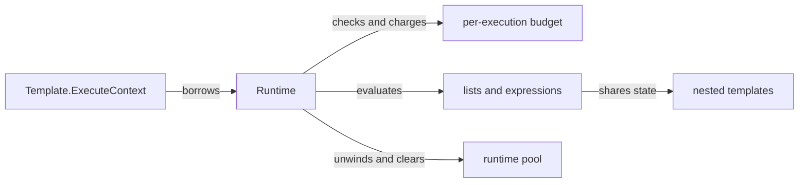

# RFC-0001: Context-aware execution with fuel and depth

| Field | Value |
| --- | --- |
| Status | Proposed; implementation not started |
| Date | 2026-11-07 |
| Baseline | Jet v6.3.3, `202464510d5b57f0afa9c5563f75babc1616682c` |
| Owner | Lane 1 |
| Depends on | No other implementation RFC; restricted guarantee also requires RFCs 0002–0004 |

## Problem and scope

`Template.Execute` has no cancellation input. `executeList` and its range loop continue without writes, recursive yielding has no depth guard, and include depth alone is capped at 100,000. A caller returning on a context select does not stop this computation. See the [audited paths](../plans/template-execution-budgets/source-audit.md).

Add interpreter enforcement without changing template syntax or making arbitrary Go code preemptible. The compatibility API remains available. No hard wall-clock or process-memory guarantee is claimed.

## Proposed public contract

```go
type ExecutionOptions struct {
    MaxSteps uint64
    MaxDepth int
    // MaxValueBytes and MaxOutputBytes are added only with RFC-0002 enforcement.
}

func (t *Template) ExecuteContext(ctx context.Context, w io.Writer,
    vars VarMap, data interface{}, opts ExecutionOptions) error
```

Keep `Execute(io.Writer, VarMap, interface{}) error`. Use syntax compatible with upstream's declared Go version; do not require `any`, generics, `errors.Join`, or a toolchain upgrade solely for this API. Nil context and negative limits are configuration errors before borrowing runtime state. Zero means unlimited for the additive low-level API, including depth; it does not mean tenant-safe defaults. Karsto selects positive validated limits separately. Do not expose fields which are silently unenforced in an intermediate release.

Propose `ErrStepLimit`, `ErrDepthLimit`, `ErrInvalidOptions` sentinels and an inspectable `LimitError` with budget kind and configured limit, wrapping its sentinel. Add error location only if it preserves the cause. `errors.Is` must reach the context error, custom cancellation cause when supported, writer error, and resource sentinel through every layer. Resolve custom cause support without silently raising upstream's minimum Go version (a build-tagged helper on Go 1.20+ is an option).

Execution and cleanup are synchronous. Return means the interpreter, including any nested execution it owns, has stopped using borrowed vars/data/writer. Caller code must not mutate borrowed values during execution. Host code retaining arguments, launching work or blocking forever is outside this contract and is forbidden in restricted mode.

## Architecture



Entry: `ExecuteContext`. Exit: completed output or inspectable error after cleanup. Failure: cancellation, step/depth exhaustion, ordinary template error, writer failure. Dependencies: Go standard library and existing Jet execution; no Karsto imports. Nested execution never acquires a fresh allowance.

### Accounting

- Charge before every executed statement/list node, loop advance (including empty bodies), expression evaluation and function invocation. Check cancellation before and after a host call. Count skipped branches only if visited, not their entire AST.
- Audit helper recursion as well as visible syntax: primary/base expressions, `isset`, field chains, equality over collections, pointer/interface traversal, yield/content, `Runtime.YieldBlock`, include, `exec`, `includeIfExists`, and inheritance traversal. Native collection comparisons must not escape depth/fuel accounting; cycles must terminate. Meter or explicitly reject unsupported native paths under RFC-0004.
- Define depth as active interpreter frames, including nested lists and recursive expression/value traversal, rather than only template call count. Check before growing the stack, decrement via unwind-safe cleanup. Publish examples of small expressions and bounded recursive blocks; exact step totals are versioned implementation detail, not stable billing units.
- Use remaining-fuel subtraction, not counters that wrap at `MaxUint64`. Avoid overflow on depth increments. Entry, completion and empty-template paths also check cancellation. A cancellation observed at the final checkpoint returns an error even if output is complete; cancellation racing after that point need not change a completed success.
- Context propagates through execution helpers. Do not store a context on long-lived templates/sets or capture a request in caches. Any internal adaptation required by existing `Runtime` callback APIs must remain execution-scoped and be cleared at return; prefer explicit context parameters.

### Terminal control flow

Jet uses panics for template errors. A private termination type may unwind that existing interpreter, but it must be sticky on the execution and survive **every** recovery site. `executeTry` and `isSet` must rethrow termination before ordinary catch handling. A callback that recovers a panic cannot reset the sticky failure; check again before accepting a result. An actual runtime fault must not be mislabeled fuel exhaustion.

Ordinary template failures remain catchable. Cancellation, budget exhaustion and restricted-policy denials are terminal. Whether all writer failures become terminal in legacy `Execute` is an explicit compatibility decision in a separate correctness PR; `ExecuteContext` must never return success after its sink fails.

### Cleanup

Inventory/reset every runtime field, not just `scope` and template data context: writer and escape writer, set, content closures, blocks, include count, counters and terminal state. Every pooled ranger clears input references before return. Register cleanup immediately after acquisition and ensure early return, cancellation, template catch, error and panic all release it once.

`try/catch` must restore scope, content, data context and writer before entering catch. Restoring only the writer can leak block parameters into catch or a later render. Do not retain the whole failed scope graph in a pool.

### Compatibility and boundaries

Unrestricted `ExecuteContext` checks before and after callbacks; it waits for an active callback to return. It cannot promise a bounded return time for arbitrary functions, `Ranger`, channels, `Renderer`, `SafeWriter`, `Stringer`, loaders, writers, or reflection methods. Preserve legacy behavior unless a separately tested correctness patch states otherwise. Restricted mode rejects capabilities that cannot honor the contract.

## Acceptance and PR sequence

1. Separate error wrapping/writer correctness and pool-cleanup fixes, with reproductions independent of the new API.
2. Add `ExecuteContext`, context propagation, sticky termination and deterministic cancellation tests.
3. Add fuel/depth, recursive-path coverage and shared nested budgets as one coherent metering change; avoid a public API advertising partially covered native computation.
4. Verify [R01–R12](../plans/template-execution-budgets/validation.md), upstream compatibility and race checks. Keep recursion probes externally bounded.

Do not call this RFC complete merely because `executeList` has a counter. The coverage audit must account for each loop, recursion and call boundary. The implementation PR states RFC-0002/0003/0004 exclusions prominently.
