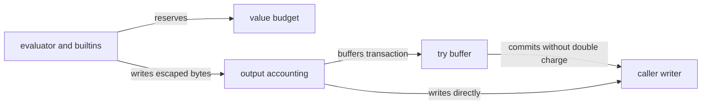

# RFC-0002: Value growth and rendered-output budgets

| Field | Value |
| --- | --- |
| Status | Proposed; implementation not started |
| Date | 2026-11-07 |
| Owner | Lane 2 |
| Depends on | RFC-0001 budget/termination seam; restricted guarantee needs RFC-0004 |

## Problem

A nine-byte result can require a 128 MiB intermediate string. `try` allocates an unbounded `bytes.Buffer`; `exec` discards output; escaping and `fastprinter` can ignore writer errors. Checking the final writer alone cannot bound these allocations or work.

## Proposed API and accounting

Add `MaxValueBytes int64` and `MaxOutputBytes int64` to `ExecutionOptions` when both are enforced. Zero remains unlimited in the low-level API; negatives fail validation. Propose `ErrValueLimit` and `ErrOutputLimit`, wrapped by RFC-0001's typed errors. Karsto chooses positive limits.

`MaxValueBytes` is a **cumulative logical allocation budget**, not a live heap estimate or RSS cap. Define and test this schedule:

| Operation | Charge before allocation |
| --- | --- |
| String/byte construction, concatenation and conversion | Destination payload bytes; reserve every separately allocated destination |
| Slice/array construction or copy | Number of new slots times declared element storage width, with checked multiplication |
| Map construction or insertion | New key/value slot storage plus new key payload, using a documented conservative logical charge; not Go map bucket bytes |
| Formatting, escaping, serialization | Reserve a proven upper bound, or stream incrementally to a charging writer without an unbounded hidden buffer |
| `try` temporary output | Bytes retained by the temporary buffer before growth; nested buffers charge each physical logical copy |
| Aliases, slices or reads that allocate nothing | No payload allocation charge; traversal still consumes steps |

A composite referring twice to the same child does not recursively re-charge the child's historical allocation. New container slots are charged. This avoids an exponential size walk on DAGs; bounded input admission and serialization traversal still have to cover cycles and depth. Initial caller data is a separate admission budget under RFC-0004, not assumed to be newly allocated by the interpreter.

Fixed-size interpreter control objects and printing scratch are bounded by runtime depth/work and are outside the produced-payload schedule; the budget is not an accounting of Go escape analysis, allocator capacity or pool misses. Dynamic formatting/serialization destinations and retained buffers are charged. Metered `ExecuteContext` diagnostics describe argument positions, identifiers and types rather than recursively formatting runtime values or the current scope. Otherwise an ordinary error after constructing an aliased DAG can allocate an exponentially expanded error string before any writer sees it. Legacy `Execute` diagnostics remain compatible.

Metered default functions use private immutable builtin descriptors so aliases retain authority without approving a function name or program counter. Public Runtime resolution and direct native arguments expose the original functions for unrestricted callback compatibility; function-valued containers remain host capabilities outside the data-only restricted profile. `SafeWriter` keeps its public signature. Unsupported native formatting/marshaling and diagnostic dump are restricted-policy denials, not size checks after a callback returns.

Owned cooperative adapters can call `Runtime.ConsumeSteps(uint64)` and `Runtime.ReserveValueBytes(int64)` before work/allocation. Both operate on the active render and terminate through the same sticky error path; negative byte requests fail with the value sentinel. These hooks neither approve arbitrary callbacks for restricted execution nor make native code preemptible. Helper registration/admission remains RFC-0004's separate identity-based contract.

Check `requested > remaining`, and check addition/multiplication overflow **before** allocating, converting, formatting or growing buffers. A length check on a returned callback value is detection after allocation and cannot certify protection. Failed reservations are terminal and cannot be caught by the template. No refunds are required; cumulative accounting makes repeated allocate/discard work consume budget.

## Architecture

Entry: value-building operations and output paths. Exit: bounded values and sink bytes. Failure: terminal reservation/output/writer errors. Dependencies: RFC-0001's shared state; restricted builtin registry from RFC-0004.

### Output semantics

Count post-escape generated bytes, including bytes generated inside `try` that later fails and output discarded by `exec`. This is a work/output generation allowance, not only successful sink bytes. A `try` buffer commit transfers already charged bytes without charging output again; copying still incurs applicable value cost. This must work at arbitrary nesting, through safe writers, HTML/JS/JSON paths, raw output and custom callbacks in unrestricted mode.

At an over-limit write, reject the entire chunk before touching the next sink. Earlier committed bytes may remain. Karsto discards its final buffer on any error. Short writes with nil error become `io.ErrShortWrite`; preserve partial-write counts and the original cause. Do not change `SafeWriter`'s public signature to solve ignored errors. A checked sink/terminal latch must detect ignored returned errors and prevent further writes.

The output budget cannot interrupt an arbitrary blocked writer. Restricted Karsto renders use a process-owned bounded memory sink; external streaming needs a cooperative writer or isolation.

### Builtin cost inventory

Audit every default in `default.go`, plus `dump.go`, `fastprinter`, equality/formatting and reflection conversions. `repeat`, `replace`, `split`, `join` equivalents, case conversion, HTML/URL escaping, JSON, `map`, `slice`, `array`, `len`, `isset`, `ints`, `exec` and `includeIfExists` each need a disposition: prepaid bounded implementation, streamed metered implementation, or explicit restricted-mode denial. A name allowlist around `strings.Repeat` is insufficient.

Bound native library operations by validated inputs/results and charge work proportional to bytes/items scanned. An O(n) operation must not cost one unit regardless of n. Document cancellation granularity for prepaid native operations; input-size admission bounds their maximum uninterrupted work. Numeric formatting width/precision must be bounded before calling the formatter. Reject overflow in integer range endpoints/advance; preserve valid range semantics and test empty/reversed/extreme ranges.

## Compatibility and review

Unlimited legacy execution keeps existing helpers. Restricted helper replacements preserve supported outputs, signatures and escaping semantics within budget. Reject unsupported capabilities explicitly; never silently remove a default name. Do not add external memory-measurement dependencies or claim exact Go allocation accounting.

Split value accounting, output transactions, and builtin adaptations into reviewable PRs, each compiling against RFC-0001. The evaluator insertion points are owned by Lane 1 until its foundational PR is ready; Lane 2 then rebases onto that exact commit, with no second runtime/budget implementation.

Acceptance: [V01–V08 and R07](../plans/template-execution-budgets/validation.md), allocation profiles showing the guard precedes amplification, and upstream output/escaping compatibility. A smaller benchmark input passing is not evidence that the original amplification is contained.
