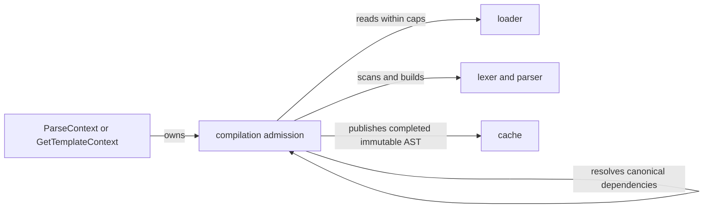

# RFC-0003: Bounded compilation and template loading

| Field | Value |
| --- | --- |
| Status | Implemented in fork; evidence in Lane 3 handoff |
| Date | 2026-11-07 |
| Owner | Lane 3 |
| Depends on | Upstream PR #236 review; RFC-0001 for runtime-triggered compilation budget |

## Problem and upstream overlap

Execution limits start too late to protect parsing, recursive imports/extends, source loading, AST growth, or a lexer worker. The existing lexer runs in a goroutine; parser recovery drains its token channel. A cancellation check in the parser alone can leave the producer blocked or force it to scan the remaining hostile source.

[CloudyKit/jet #236](https://github.com/CloudyKit/jet/pull/236), inspected at `c9ec08935ddf15eaf9328128e008faf0bef5e079`, already proposes canonical-path active-chain cycle detection with alias, diamond and concurrent tests. It is open, not merged. Re-check it before coding; extend or consume that work with attribution. Do not submit competing cyclic-import code as new work. A finite acyclic dependency chain and deeply nested expressions still need bounds.

## Proposed public contract

A context-aware compile entry point and immutable parse policy must cover `Parse`, named loads and runtime includes. Candidate shape, subject to compatibility review:

```go
type ParseOptions struct {
    MaxSourceBytes int64
    MaxTotalSourceBytes int64
    MaxNodes uint64
    MaxSteps uint64
    MaxDepth int
    MaxTemplates uint64
}

func (s *Set) ParseContext(ctx context.Context, name, source string, opts ParseOptions) (*Template, error)
func (s *Set) GetTemplateContext(ctx context.Context, name string, opts ParseOptions) (*Template, error)
```

Zero is unlimited at the low-level boundary; negatives are invalid. Source bytes bound each file; total bytes and template count bound the dependency graph admitted for one operation; nodes bound AST construction; depth bounds parser recursion and active dependency nesting. Define counts for repeated imports and cache hits explicitly: charge the admitted graph's unique canonical templates once for size/count, charge every traversal for work, and track active ancestors separately for cycle detection. Development mode repeated parsing also charges actual work.

Parser work is also bounded by `MaxSteps`: each scanned byte, consumed token, AST construction and dependency/cache visit consumes work. This is separate from unique graph size: development-mode diamonds can reparse the same source exponentially without increasing unique bytes or template count. Cache reuse avoids scan work but still charges graph visits and admitted AST nodes. Step totals are implementation details, not stable billing units.

Validate before source copying, token/AST allocation and recursive descent. Bound error diagnostics (including line-number lookup) to prevent huge messages or repeated whole-source scans. Check cancellation in long token scans and parsing loops, not only between complete tokens. Runtime loading consumes the render's remaining compilation allowance and deadline; `exec` cannot reset it.

## Architecture and ownership



Entry: inline, named and runtime-triggered compilation. Exit: fully admitted immutable template or error after lexer/read cleanup. Failure: cancellation, source/node/depth/template limit, dependency cycle, loader error. Dependencies: existing Set/Loader/Cache interfaces; no application imports.

Prefer a synchronous pull lexer if it can preserve syntax with a small reviewable change. Otherwise use cancellation-aware token sends, an owned stop signal, and an explicit join on every parse exit. Merely draining a producer without cancelling its scanning is not sufficient. A parse return must not leave a lexer or reader using source/context.

### Loaders and cache

Keep existing `Loader` implementations valid in unrestricted mode. Arbitrary `Exists`/`Open`/`Read` can block; an optional context-aware loader interface may be additive, but claiming it is cooperative does not force native code to stop. Restricted mode must use bounded, vetted sources or an admitted immutable in-memory template bundle; do not emulate cancellation by abandoning a loader goroutine. Bound actual bytes read, not just file metadata. Preserve path normalization, extension lookup, relative includes and valid shared imports.

No parse budget, active-chain map or context lives on shared `Set`/`Template` state. Cached AST metadata must support checking a stricter caller's policy; a template parsed under unlimited settings must not bypass later limits on a cache hit. Bind policy/capability identity to a cache namespace or validate immutable cost metadata and all dependencies. Never mutate a cached tree to attach a request's limits. Dynamic include names cannot access another tenant's bundle; authorize canonical names before cache lookup.

## Compatibility and tests

Legacy entry points retain their signatures. Cycle rejection is an independent correctness fix. New limits affect only opted-in paths. Custom delimiters/comments, malformed UTF-8, long text literals, imports, extends, loader errors and development mode retain defined behavior.

Required [P01–P07](../plans/template-execution-budgets/validation.md): cycle failures in bounded subprocesses, deep acyclic dependencies, nested expressions and lists, cancellation during scanning/loading, no lexer worker after return, cache warm/cold policy parity, canonical path aliases and concurrent diamond graphs. Test source limits at N-1/N/N+1 bytes and arithmetic overflow. Compilation and cached execution have separate performance measurements.
