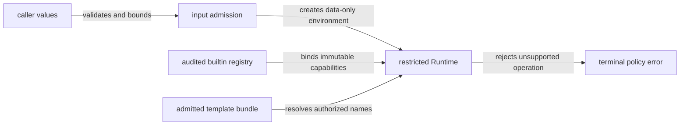

# RFC-0004: An enforceable restricted capability profile

| Field | Value |
| --- | --- |
| Status | Not enabled; admission preparation implemented, J05 acceptance pending |
| Date | 2026-11-07 |
| Owner | Lane 3; Lane 1 owns evaluator hooks, Lane 2 owns builtin implementations |
| Depends on | RFCs 0001–0003 before any sandbox claim |

## Problem

Metering interpreter dispatch does not constrain native Go code. Function values can arrive through globals, vars, data, methods, builtin return values, interface implementations or reflection. `fmt.Stringer`, JSON marshaling, custom renderers, safe writers, channel ranges, custom rangers and loaders are all execution capabilities. A denylist of function names misses aliases and shadowing.

The unrestricted API must preserve Jet's extension points. The restricted profile must make unsupported capabilities unavailable by construction and reject them visibly. It is an in-process interpreter contract, not hard CPU, memory or crash isolation.

## Proposed policy

Use an immutable per-Set capability policy selected at construction; the exact option spelling is pending API review. Default Set behavior remains unrestricted. The restricted selection requires nonzero execution/parse/input budgets and a policy-bound compile cache. It must not infer trust from whether a deadline exists. Validate depth against a conservative supported ceiling established by stack-bound tests; a positive but enormous configured depth is not a safe configuration. Document configuration assumptions and reject settings that invalidate the restricted contract.

| Capability | Unrestricted | Restricted |
| --- | --- | --- |
| Primitive data, strings, data-only slices/maps | Existing behavior | Validated/admitted before execution, bounded bytes/items/depth |
| Structs/pointers/interfaces | Existing behavior | Convert through bounded explicit adapters to data-only values; no implicit methods |
| Registered arbitrary funcs or `jet.Func` | Existing behavior; synchronous ownership only | Deny, including globals, aliases, nested inputs and function returns |
| Audited builtin bindings | Existing behavior | Allow by immutable binding identity and metered contract, not identifier spelling |
| `Renderer`, `Ranger`, `SafeWriter`, Stringer/Marshaler and similar hooks | Existing behavior | Deny unless an internal audited implementation with explicit metering owns the binding |
| Channels, unsafe pointers, cyclic input graphs | Existing behavior | Deny before traversal/invocation; repeated noncyclic sharing allowed within admission cost |
| Includes, imports, extends, exec and block recursion | Existing syntax | Preserve through admitted template namespace and shared budgets |
| Reflection field/index access | Existing behavior | Internal data access only; no method discovery/invocation or arbitrary conversion |

Separate **input admission** from produced-value accounting: bound initial bytes, collection entries, traversal steps and depth. Use iterative or depth-limited traversal with visited/active sets; reject cycles before formatting/equality/serialization. Decide whether to copy accepted inputs into immutable execution-owned data (recommended) or enforce a documented borrow contract; charge the conversion before allocating. Copying gives stable snapshots, but cannot make a caller concurrently mutating a Go map during admission safe. Caller synchronization remains required.

### Host helpers and compatibility

Do not silently turn `RegisterFunc(name, fn)` into approval for restricted execution. Existing trusted consumers retain a documented unrestricted path. Tenant engines use audited bindings with input constraints, work charge, pre-allocation result bound and cancellation behavior. A cooperative context parameter alone does not make a function safe.

Karsto's current helpers must each have a reviewed disposition. Preserve names and outputs for supported inputs by implementing bounded equivalents in the owning layer. Examples: `formatNumber` validates precision; `replace`/`join` compute destination size; `dict`/`list`/`reverse` charge container slots; `now` and `formatDate` use vetted bounded time values. No blanket claim that defaults are cheap or safe.

Avoid reflective auto-injection of context into every existing function signature: it changes call arity and hides trust. If a public cooperative callback API is useful, propose it separately for unrestricted mode, with explicit ownership and reentry rules. A callback calling public ExecuteContext recursively gets a new top-level budget unless the API explicitly propagates the active execution; restricted mode cannot expose that escape route.

## Architecture

Entry: restricted Set and its render inputs. Exit: output/error using RFC-0001 lifetime. Failure: input/capability denial or shared budget exhaustion; template catch cannot suppress denial. Dependencies: RFC-0002 metered builtin contracts and RFC-0003 admission/cache policy.

## Review gates

Enumerate all invocation and implicit conversion sites. Maintain tests for function aliases, shadowing builtin names, functions nested in maps/slices, method values, string/JSON formatting hooks, cyclic values, channels, custom rangers/renderers/safe writers, global mutation, restricted/unrestricted cache sharing and reentry. Reject a new AST or value kind by default until it has a disposition.

Do not expose partially implemented restricted mode as safe. A trusted `ExecuteContext` release can precede this RFC with explicit exclusions; Karsto's tenant adoption cannot. A block in arbitrary host code still requires OS process isolation for hard CPU/memory/crash containment. Such isolation also requires handling callbacks and I/O outside the process boundary deliberately.

Acceptance: [C01–C07](../plans/template-execution-budgets/validation.md) and a completed, source-linked capability inventory signed off in the PR. A policy document alone is not enforcement.

## Implementation gate

The fork has private input-snapshot and immutable bundle helpers plus a [source capability inventory](../plans/template-execution-budgets/lane-3-capabilities.md). These do not select or enforce a restricted rendering profile. Input preparation supports method-free primitive values, strings, arrays/slices (including byte-slice snapshots) and string-keyed maps. Unsupported keys, structs/pointers, methods, functions, channels, unsafe values and cycles are denied; shared acyclic children consume admission per copied occurrence. Caller synchronization is required during admission. Bundle construction copies the namespace under positive source/total/template caps and a 1,024-byte name ceiling.

J08 waits for the accepted builtin/value contract, including minimum-Go JSON bounds and immutable audited descriptor identity. No public callback registration grants approval. The owner's current direction is fork-only development/review; no new upstream PR is authorized. Compilation and execution budgets remain useful independently and do not establish a sandbox.
