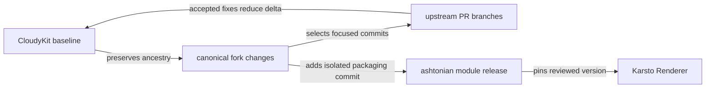

# RFC-0005: Fork distribution and upstream review strategy

| Field | Value |
| --- | --- |
| Status | Fork selected; distribution and PR plan proposed |
| Date | 2026-11-07 |
| Owner | Lane 4 |
| Baseline | CloudyKit/jet v6.3.3, `202464510d5b57f0afa9c5563f75babc1616682c` |

## Decision

Maintain [ashtonian/jet](https://github.com/ashtonian/jet) with preserved upstream history and license. Keep one canonical interpreter implementation; no copy under Karsto's `internal/jet`, no downstream AST rewriting, no second renderer.

Recommended released module: `github.com/ashtonian/jet/v6`. Consumers explicitly pin a reviewed fork tag or immutable pseudo-version. Current planning branch deliberately leaves `go.mod` and imports unchanged. Make the eventual module/import rewrite a **separate fork-only packaging commit**, after upstream-oriented implementation commits. Do not invent a release tag or consume an unpushed local replacement.

| Strategy | Benefits | Costs / compatibility |
| --- | --- | --- |
| Direct fork import (chosen proposal) | Transitive library consumers resolve the intended dependency; provenance visible; no application replace required | Fork Jet types differ from CloudyKit Jet types; update self-imports, examples and submodules; mixing both does not share types |
| Preserve upstream module + pinned replace | Consumer source import unchanged; runtime diffs apply upstream directly | Replace directives in dependency modules are ignored by downstream main modules; every application must carry the override; easy to silently get unsafe upstream runtime |

Karsto's Renderer exposes no Jet types, reducing the public blast radius. Confirm this at the integration SHA rather than assuming all downstream consumers are insulated. Audit every go.mod, self-import and external example; a fork library importing upstream Jet subpackages can accidentally load two implementations.

## Upstream contribution shape

The [current publication policy](../plans/template-execution-budgets/plan.md#current-publication-policy) holds all new upstream submissions and keeps internal plans/RFCs in the fork. The following describes a possible future contribution shape, not permission to submit. [The work register](../plans/template-execution-budgets/upstream-prs.md) tracks behavior and dependencies without requiring a separate PR for each item.

If upstream submission is explicitly authorized later, each branch is based on the then-current upstream master or clearly identified prerequisite PR. It contains only the applicable generic implementation, tests, public API docs and benchmarks. Exclude fork module renaming, internal plans/RFCs and work assignments, Karsto defaults/E-codes, local host paths and application policy.

Temporary upstream submission branches derive from canonical commits; they are not a second maintained runtime. Record canonical commit → submission commit → upstream PR/merge mapping. Retire the corresponding fork patch after upstream acceptance and rerun the matrix. Do not maintain cherry-picked divergent fixes indefinitely.

Preserve upstream Go compatibility and test conventions unless maintainers agree to a version change. This program does not import Karsto configuration, HTTP clients, logging, metrics or error libraries into Jet. Preserve Apache-2.0 headers and third-party authorship. If consuming PR #236 or #234, inspect their final state and preserve provenance rather than recreate their changes.

A ready PR begins with an observed failure and its bounded reproducer, explains resulting behavior and API/compatibility effects, and includes exact passing evidence. Disclose the remaining security boundary; avoid promising a complete sandbox from the first runtime patch. Do not send a giant combined fork diff upstream or require maintainers to read the whole internal RFC set.

## Release architecture

Entry: reviewed generic changes. Exit: upstream proposals and pinned fork artifact. Failure: compatibility drift, missing budget coverage or unverified source blocks release. Dependencies: upstream history, RFCs 0001–0004 and downstream validation; no deployment change in this planning batch.

## Gates and maintenance

- Runtime-only releases may explicitly provide best-effort cancellation around unrestricted callbacks; they do not satisfy tenant acceptance.
- Tenant-ready release requires all R/V/P/C/I cases, normal and race compatibility, clear supported helper list, and performance report. No merge of partial tenant protection or closure of #209.
- Compare upstream, fork legacy Execute, fork metered ExecuteContext and integrated Karsto separately. Target <=20% median overhead across representative execution workloads; report actual values, p99, allocations, CPU and overshoot. A missed target opens measured optimization work; it never permits dropping checks.
- Track new upstream releases and safety-related PRs before every fork release. Quarterly review is a backstop, not a substitute for responding to security fixes. Store the merge base and outstanding patch inventory with releases.
- Sign task commits using effective Git identity, verify locally, then verify GitHub status. Preserve third-party authorship and backup refs before any authorized rewrite; never rewrite unrelated history.

Acceptance: reproducible fork module resolution in an external consumer without a replace directive; upstream submission diffs free of packaging/application changes; exact release/CI evidence and remaining limitations. No release or upstream submission is performed by these planning documents.
